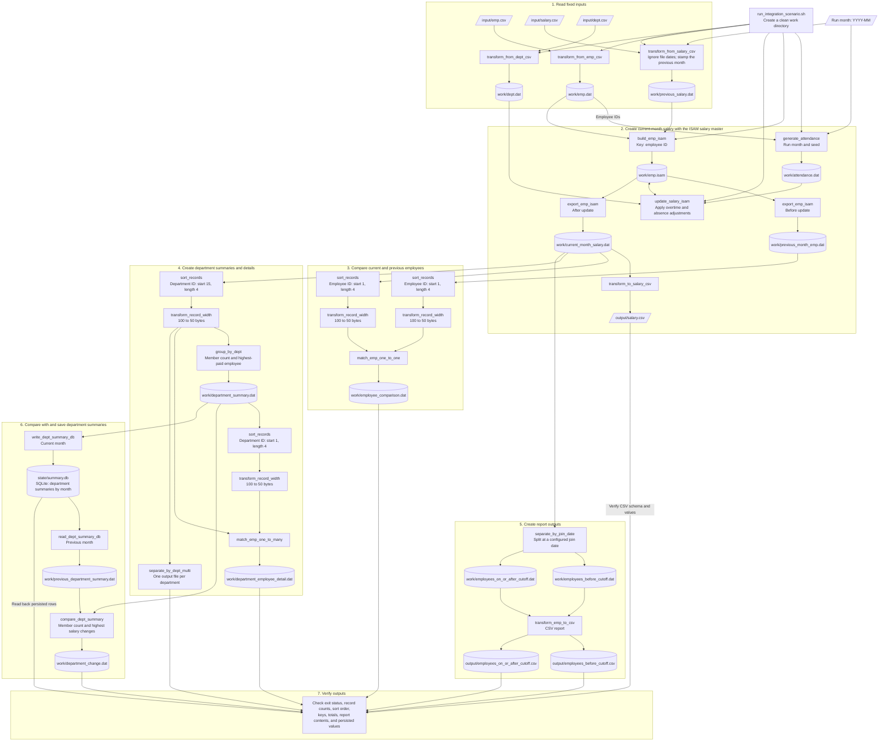

# Application Integration Test Scenarios

This document proposes an end-to-end batch scenario that connects the COBOL
examples under `src/`. The shell script acts as a job controller: it prepares
the work directory, runs each step in order, and stops when a step fails.
Input conversion and other batch steps use COBOL programs. This is a shell-based
JCL-style example, not a proposal to add a mainframe JCL runtime.

The scenario uses employees, departments, and salaries so that each processing
step has a concrete business purpose. Existing COBOL programs are reused where
possible. The outbound salary CSV, SQLite, and ISAM adapters remain additional
work and are marked as such in the flow.

## End-to-End Flow

## Components

COBOL program names follow the existing `verb_object` convention, and each
program does one thing. COBOL programs live under `src/`; integration shell
scripts live under `scripts/integration/`.

| Component | Folder | Status | Role |
| --- | --- | --- | --- |
| `run_integration_scenario.sh` | `scripts/integration/` | Additional | Shell job controller (JCL-style). |
| `transform_from_emp_csv` | `src/transforming/` | Implemented | Convert `input/emp.csv` to fixed-length `emp.dat`. |
| `transform_from_dept_csv` | `src/transforming/` | Implemented | Convert `input/dept.csv` to fixed-length `dept.dat`. |
| `transform_from_salary_csv` | `src/transforming/` | Implemented | Convert `input/salary.csv` to `previous_salary.dat`, ignoring its dates and stamping the previous month. |
| `generate_attendance` | `src/generating/` | Implemented | Generate `attendance.dat` from `emp.dat`, the run month, and a seed. |
| `build_emp_isam` | `src/indexing/` | Additional | Build `emp.isam` from `emp.dat` and `previous_salary.dat`. |
| `update_salary_isam` | `src/indexing/` | Additional | Apply attendance adjustments to each ISAM record by key. |
| `export_emp_isam` | `src/indexing/` | Additional | Export ISAM records in key order (before and after the update). |
| `sort_records` | `src/sorting/` | Existing | Sort employee and summary files by employee ID or department ID. |
| `transform_record_width` | `src/transforming/` | Additional | Convert sorted 100-byte records to 50 bytes. |
| `match_emp_one_to_one` | `src/matching/` | Existing | Compare current and previous employee records by employee ID. |
| `group_by_dept` | `src/grouping/` | Existing | Create department member counts and highest-paid employee summaries. |
| `match_emp_one_to_many` | `src/matching/` | Existing | Join department summaries to the employees belonging to each department. |
| `separate_by_dept_multi` | `src/separating/` | Existing | Write one employee file per department. |
| `separate_by_join_date` | `src/separating/` | Existing | Split employees into two files at a configured join date. |
| `transform_emp_to_csv` | `src/transforming/` | Existing | Convert employee records into a display-oriented CSV report. |
| `transform_to_salary_csv` | `src/transforming/` | Additional | Write `output/salary.csv` in the canonical schema. |
| `read_dept_summary_db` | `src/database/` | Additional | Read the previous month's department summaries from SQLite. |
| `compare_dept_summary` | `src/matching/` | Additional | Compare previous and current department summaries. |
| `write_dept_summary_db` | `src/database/` | Additional | Save the current month's department summaries to SQLite. |
| `generate_emp` | `src/generating/` | Existing | Optional large-volume input only; its random values are not suitable for exact expected results. |

The SQLite database lives outside the per-run work directory so a later run can
read the previous month's summaries. SQLite and the ISAM file are not shared:
ISAM serves the salary calculation, and SQLite serves the department summary
history.

## Copybooks

Keep the existing employee and department summary layouts stable for the
examples that already use them. Use separate copybooks where the integration
flow has a different record purpose or layout:

| Copybook | Status | Record length | Flow usage |
| --- | --- | ---: | --- |
| `src/copies/emp_rec.cpy` | Existing, reusable; length comment corrected | 42 bytes | Employee roster and the employee portion of reports and joins. |
| `src/copies/dept_rec.cpy` | Existing, reusable | 32 bytes | Department summary and the department portion of the one-to-many join. |
| `src/copies/quick_sort.cpy` | Existing, not used by this flow | — | Retained for the existing quick-sort implementation. |
| `src/copies/dept_master_rec.cpy` | New | 14 bytes | Department input records containing department ID and name. |
| `src/copies/salary_rec.cpy` | New | 16 bytes | Previous-month salary input and salary lookup data: employee ID, month, and monthly salary. |
| `src/copies/attendance_rec.cpy` | New | 9 bytes | Generated attendance: employee ID, overtime hours, and absence days. |
| `src/copies/emp_salary_rec.cpy` | New | 48 bytes | ISAM employee record: the existing 42-byte `EMP-REC` plus its salary month. |

No existing field layout needs to change for this flow. In particular,
`dept_rec.cpy` is the summary layout with manager and member-count fields; it
is not the smaller department master input layout. `emp_salary_rec.cpy`
includes `emp_rec.cpy` so the employee fields remain consistent. Keep
example-specific padding outside these shared layouts.

## Fixed Inputs and Salary Generator

Keep these three inputs as small, checked-in fixtures; do not regenerate them
for each run. The COBOL readers write fixed-length records for downstream
programs. Employee and department CSV rows use unquoted fields with no embedded
commas or quotation marks. Their optional first-line headers must match the
schemas below exactly. Malformed rows fail with a nonzero status so the job
controller stops.

| File | Format | Content |
| --- | --- | --- |
| `input/emp.csv` | CSV | `employee_id,employee_name,department_id,join_date` |
| `input/dept.csv` | CSV | `department_id,department_name` |
| `input/salary.csv` | CSV | Previous-month salaries: `salary_month,employee_id,monthly_salary`. |

Employee CSV rows contain exactly four fields: a four-digit employee ID, a
nonempty name of at most 10 bytes, a four-digit department ID, and an
eight-digit join date (`YYYYMMDD`). The reader writes the 42-byte `EMP-REC`;
the department name is blank and salary is zero because those values are
provided separately by the department and salary inputs. Department CSV rows
contain exactly two fields: a four-digit department ID and a nonempty name of
at most 10 bytes. The reader writes the 14-byte department master record.

Run the employee and department readers as
`transform_from_emp_csv INPUT_CSV OUTPUT_FILE` and
`transform_from_dept_csv INPUT_CSV OUTPUT_FILE`.

The salary CSV reader ignores the `salary_month` values in the file and
stamps every row with the month before `--run-month` (for example
`2026-11` gives `202610`). This lets the same file be reused in any run month,
including the January-to-December year boundary, and lets the previous run's
output be fed back in unchanged. It writes a fixed-length intermediate record:
employee ID `9(004)`, salary month `9(006)` (`YYYYMM`), and monthly salary
`9(006)`, defined in `src/copies/salary_rec.cpy`. The load step builds the
ISAM salary master from this file.

Run the reader as
`transform_from_salary_csv INPUT_CSV OUTPUT_FILE --run-month YYYY-MM`.
It accepts an optional first-line header
`salary_month,employee_id,monthly_salary`. Data rows must contain exactly
three comma-separated fields, with a four-digit employee ID and a six-digit
monthly salary. The salary-month field is ignored; malformed data rows fail
the program with a nonzero status.

Add one focused attendance generator that writes only the fixed-length
`work/attendance.dat`. It reads employee IDs from `emp.dat` and takes the run
month and a seed, so overtime hours and absence days vary per employee and per
month yet are reproducible for the same arguments. Each record contains
employee ID `9(004)`, overtime hours `9(003)`, and absence days `9(002)`, as
defined in `src/copies/attendance_rec.cpy`. The generator does not read
salaries, decide the calculation rule, create other files, or write expected
results. Tests that need exact values pass a fixed seed, or use a small fixed
table for a few employees.

The calculation rule belongs to the salary program. For example: current
salary = previous salary + overtime hours x hourly rate - absence days x daily
deduction, with the rates defined as documented constants. This rule is a
scenario decision and can be changed. An employee without an attendance record
has zero overtime and zero absence, so the salary is unchanged. An attendance
record for an unknown employee is reported as a warning.

`output/salary.csv` uses the same schema as `input/salary.csv`, with
unformatted numbers. Copy it over the input and run the job again with the
next run month: the salaries from the first run become the previous month, so
results may change from run to run. The run month and seed affect attendance
generation, though different arguments may still produce the same values.
Rebuild the ISAM file in each run's fresh work directory, and key
SQLite rows by month (replace the row for the same run month) so reruns do
not duplicate rows. The first run has no previous-month summaries and reports
every department as new.

Use `generate_emp.cbl` only when testing throughput or large-file behavior;
do not use its random records to assert exact join or aggregate results.

The employee record is 42 bytes before any example-specific padding. Its
employee ID starts at position 1 and its department ID starts at position 15.
The department record is 32 bytes before padding, with department ID at
position 1. Keep sort key positions and lengths aligned with the record layout
used by each program.

There is a record-width boundary to resolve when wiring these examples:
`sort_records.cbl` reads and writes 100-byte records, while the matching,
grouping, and separating examples shown here read 50-byte records. The flow
therefore includes a record-width normalization step after each sort. This can
be a small adapter or a carefully tested change to the sort program's record
width; do not pass the sort output directly to a 50-byte consumer without
verifying the runtime's line-sequential behavior.

## Suggested Test Cases

Use small, deterministic fixtures for functional tests. Include cases that
exercise:

- An employee with overtime, one with absences, one with both, and one with
  no attendance row (salary unchanged).
- An attendance record whose employee ID is not in `emp.csv`, and a salary
  row whose employee ID is not in the roster.
- A salary CSV whose date column holds an arbitrary month, to confirm it is
  ignored.
- A chained run: feed the first run's `output/salary.csv` into a second run
  and confirm the salaries change as expected.
- A department with multiple employees, a department with one employee, and an
  employee whose department code is unknown.
- Employees on both sides of the join-date cutoff, including a record exactly
  on the cutoff.
- Empty input and malformed `salary.csv`, `emp.csv`, or `dept.csv`
  records at the input boundaries.

For each run, verify that:

1. The shell job stops and reports failure if any step returns a non-zero exit
   status.
2. The employee comparison includes every employee from the carried-forward
   roster and identifies the expected salary changes.
3. Grouped department member counts and highest-paid employees match the
   fixture, and the one-to-many output contains the expected employee/
   department pairs.
4. The department split files and join-date split files together contain the
   expected records without duplication or loss.
5. CSV report values and record counts match the fixed input and the
   transformation rules.
6. SQLite contains one expected summary row per department and month, and
   the department changes match the previous and current summaries.
7. The reader stamps the month before the run month, including the year
   boundary, and a rerun does not duplicate SQLite rows.
8. In a chained run, the second run's previous-month salaries equal the first
   run's current-month salaries.

`separate_by_dept_multi` opens its department output files in extend mode.
Run each test in a fresh work directory, or explicitly clear prior outputs
before rerunning, so old records cannot make a test appear to pass.
